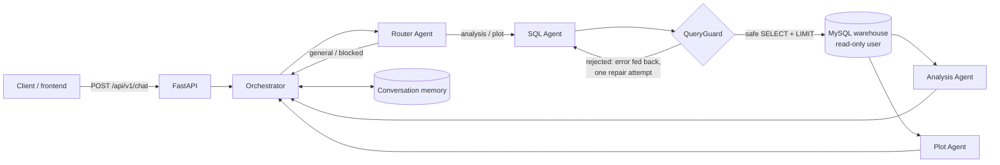

# Ask Your Database

[](https://github.com/amjaddwikat/ask-your-database/actions/workflows/ci.yml)

Ask questions about a SQL data warehouse in plain English and get back an analysis, the SQL that
answered it, and a chart. Four LLM agents cooperate behind a single FastAPI endpoint, and generated
SQL goes through three layers of safety checks before it touches the database.

> **"Which contract type pays late most often? Show it as a chart."**
>
> → Router decides it's a chart request → SQL Agent writes a query → QueryGuard validates it →
> MySQL runs it read-only → Analysis Agent and Plot Agent run **in parallel** → the client gets
> Markdown insights + a chart spec + the rows.

## Architecture



| Agent | Job | Output (validated with Pydantic) |
|---|---|---|
| **Router** | Classifies the message, blocks unsafe/off-topic requests, rewrites follow-ups ("same for 2024") into self-contained questions | `{action, rephrased_question, message}` |
| **SQL** | Writes one MySQL `SELECT` from the live, introspected schema | `{sql, explanation}` |
| **Analysis** | Explains the rows, strictly grounded in the data | Markdown |
| **Plot** | Picks a chart type and axes that exist in the result | `{chart_type, x, y, ...}` |

## Engineering decisions

**LLM-generated SQL is untrusted input.** It's checked by three independent layers, so no single
mistake can damage data:
1. **`QueryGuard`** ([`app/db/guard.py`](backend/app/db/guard.py)) parses the SQL into an AST
   with [sqlglot](https://github.com/tobymao/sqlglot) and only accepts a single `SELECT`/`WITH`/
   `UNION`. It rejects DML/DDL anywhere in the tree (including subqueries), multiple statements,
   tables outside an allow-list (no `mysql.*` or `information_schema`), dangerous functions
   (`SLEEP`, `BENCHMARK`, `LOAD_FILE`...), `INTO OUTFILE` and `FOR UPDATE`. It also enforces a row
   limit.
2. **A read-only database user** that has only `SELECT` on the warehouse schema
   ([`db/init/03-users.sh`](db/init/03-users.sh)).
3. **Hardened sessions**: every pooled connection runs `SET SESSION TRANSACTION READ ONLY` and a
   server-side `MAX_EXECUTION_TIME`, so runaway queries are cancelled by MySQL itself.

There's an integration test that bypasses the guard on purpose and proves the database still
refuses to write.

**Self-correcting SQL.** If the guard or the database rejects a query, the error message goes back
to the SQL Agent for one repair attempt. This fixes most hallucinated column names without
involving the user.

**Structured outputs, validated.** Every agent that returns data must match a Pydantic model. On a
validation failure the model is re-asked with the exact error. The Plot Agent's `x`/`y` are checked
against the real result columns, so the frontend never receives a chart pointing at a missing field.

**Graceful degradation.** If the chart fails, the user still gets the analysis. If the LLM provider
is down, the API returns a clear `502` instead of a stack trace.

**Schema comes from the database, not the prompt.** Tables, columns and foreign keys are read from
`information_schema` at startup, so prompts can't drift out of sync with the warehouse.

**Concurrency where it's free.** For chart requests, analysis and chart generation are independent,
so they run concurrently with `asyncio.gather`. The whole stack is async: FastAPI, SQLAlchemy 2.0
async with connection pooling, and httpx.

**Observable.** Every response includes a `trace` of which agents ran and how long each took. Every
log line and response carries an `X-Request-ID`.

**Provider-agnostic.** Agents depend on a small `LLMClient` protocol. Gemini is one implementation
(the key is sent in a header, never in the URL), and tests use a scripted fake.

## API

Interactive docs at `http://localhost:8000/docs` once running.

| Method | Path | Description |
|---|---|---|
| `POST` | `/api/v1/chat` | Ask a question. Omit `session_id` to start a conversation. |
| `GET` | `/api/v1/sessions/{id}/messages` | Conversation history |
| `GET` | `/api/v1/schema` | Tables and columns the assistant can query |
| `GET` | `/health`, `/health/ready` | Liveness and readiness (checks the DB) probes |

All `/api/v1` routes require an `X-API-Key` header. Errors share one envelope:
`{"error": {"code", "message", "request_id"}}`.

```bash
curl -s localhost:8000/api/v1/chat \
  -H "X-API-Key: $API_KEY" -H "Content-Type: application/json" \
  -d '{"message": "Average bill per service type in 2025"}'
```

```jsonc
{
  "session_id": "3f9c...",
  "type": "analysis",                 // general | blocked | clarification | analysis | plot | error
  "message": "Premium **TV** plans have the highest average bill ...",
  "query": {
    "sql": "SELECT s.ServiceType, ROUND(AVG(f.BillAmount), 2) AS avg_bill ... LIMIT 500",
    "explanation": "Averages 2025 bills per service type.",
    "columns": ["ServiceType", "avg_bill"],
    "rows": [{"ServiceType": "TV", "avg_bill": 61.4}, ...],
    "row_count": 4, "truncated": false
  },
  "chart": null,
  "trace": [
    {"step": "router", "duration_ms": 612.4, "detail": "analysis"},
    {"step": "sql", "duration_ms": 1033.0, "detail": "attempt 1"},
    {"step": "warehouse", "duration_ms": 8.1, "detail": "4 rows"},
    {"step": "analysis", "duration_ms": 1544.7, "detail": null}
  ]
}
```

## Run it

Requirements: Docker, and a free [Gemini API key](https://aistudio.google.com/apikey).

```bash
cp .env.example .env        # then fill in GEMINI_API_KEY and the passwords
docker compose up --build
```

MySQL starts with a deterministic sample telecom warehouse: 400 customers, 12 services and 24
months of billing, in a star schema ([`db/init`](db/init)). Open `http://localhost:8000/docs` and
try:

- *Which contract type has the highest late-payment rate?*
- *Plot monthly revenue for 2025.*
- *Top 5 cities by total usage minutes.* → then *Same, but only for Premium plans.*
- *Delete all customers.* (blocked by the router; and if it got through, by the guard and the DB)

## Develop

```bash
cd backend
python -m venv .venv && . .venv/bin/activate     # Windows: .venv\Scripts\activate
pip install -e ".[dev]"

pytest                       # unit tests: no network, LLM and warehouse are faked
ruff check . && mypy app     # lint + strict type checking

docker compose up -d mysql   # integration tests against real MySQL
WAREHOUSE_URL=mysql+aiomysql://warehouse_ro:<password>@localhost:3306/telecom_dw pytest -m integration
```

CI runs lint, strict mypy, unit tests, integration tests against MySQL, and a Docker build on every
push.

```
backend/
  app/
    main.py            app factory, lifespan wiring, middleware, error envelope
    api.py             routes + API-key auth
    orchestrator.py    the agent pipeline (routing, repair loop, parallel fan-out)
    agents/            router, sql, analysis, plot + prompts/*.md
    db/guard.py        AST-based SQL validation
    db/warehouse.py    pooled read-only execution, schema introspection
    db/memory.py       conversation history
    llm/client.py      LLM protocol, Gemini client, structured-output retries
  tests/               unit tests + integration/ (real MySQL)
db/init/               warehouse schema, seed data, least-privilege users
legacy/n8n/            the original n8n prototype (see below)
```

## How this project evolved

I first built the pipeline as four **n8n** workflows ([`legacy/n8n`](legacy/n8n)), with a small
FastAPI service that executed SQL. It proved the idea, but it also showed me what had to change
before I'd trust it:

| Prototype (n8n) | Now |
|---|---|
| The SQL endpoint executed *any* statement it received and committed it | Three-layer read-only enforcement, tested |
| The frontend orchestrated four HTTP calls to the agents | One `/chat` endpoint; the orchestration is server-side |
| Conversation history read with string-interpolated SQL | Parameterised queries via SQLAlchemy |
| Schema hard-coded in the prompt (and drifting from the DB) | Introspected from `information_schema` at startup |
| Regex clean-up of LLM output scattered across nodes | Pydantic-validated structured output with retry |
| Sequential agents | Analysis and plot run concurrently |
| No tests | Unit and integration tests, CI |

## Limitations and next steps

- Authentication is a single shared API key. Per-user auth (JWT) and rate limiting would come next.
- Responses aren't streamed. Server-sent events would show each agent's progress live.
- Schema migrations for the memory table use `create_all`. Alembic would replace that in production.
- Answer-quality evaluation: a small set of benchmark questions with expected SQL results, run in CI.
